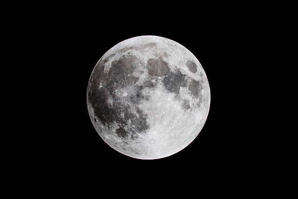

# Lunar Surface Composition Predictor

**"The moon is the first milestone on the road to the stars." - Arthur C. Clarke**

## First of all, why should I care?

The moon is the closest celestial body to the moon, clothed in immense treasures. Materials from lunar soil as well as astroid impacts contain a diverse range of materials, many of which are highly demanded on earth. Moving mining operations to the moon could drastically reduce pollutions on earth caused by mining, as long as the mined materials can be cheaply transported back to earth.

Before any organization could mine the moon for a certain material, they will need to identify where on the moon to mine. Though being only 1/4 of the diameter of earth, the moon is still extremely large, with a surface area similar that to the entire continent of Asia. Therefore, a low-cost and efficient way to estimate the composition of regions on the moon would be incredibly valuable to future mining operations.

## How to install

1. Clone the repo via `git clone https://github.com/SnowCheetos/Moon-Composition-Predictor.git`.
2. Install prerequisites via `pip install requirements.txt`.
3. Launch the interface via `python ui.py`. 

## Video Demo

## Disclaimer

**This project is for educational purposes only, it currently only serves as a proof of concept. If your organization happened to be preparing for a moon mining operation (I know... just putting it out there anyway...), this is not a reliable source to estimate the lunar composition.**

microperceptron@mvpp-edge:~ $ cat /etc/systemd/system/openems.service
[Unit]
Description=OpenEMS Edge
After=network.target

[Service]
User=root
Group=root
Type=notify
WorkingDirectory=/usr/lib/openems
ExecStart=/usr/bin/java -Dfelix.cm.dir=/etc/openems.d/ -jar /usr/lib/openems/openems.jar
SuccessExitStatus=143
Restart=always
RestartSec=10
WatchdogSec=60

[Install]
WantedBy=multi-user.target
